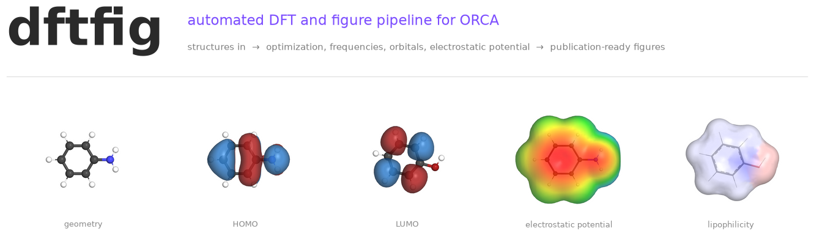
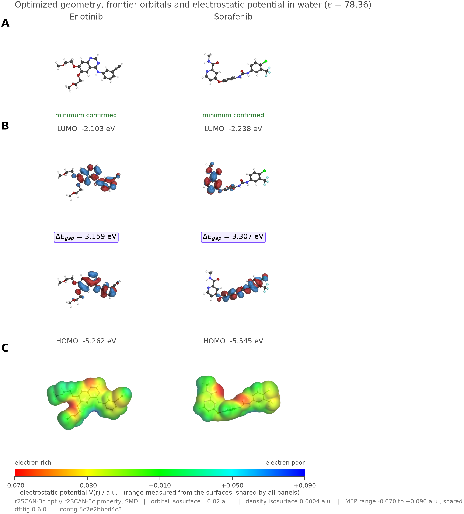
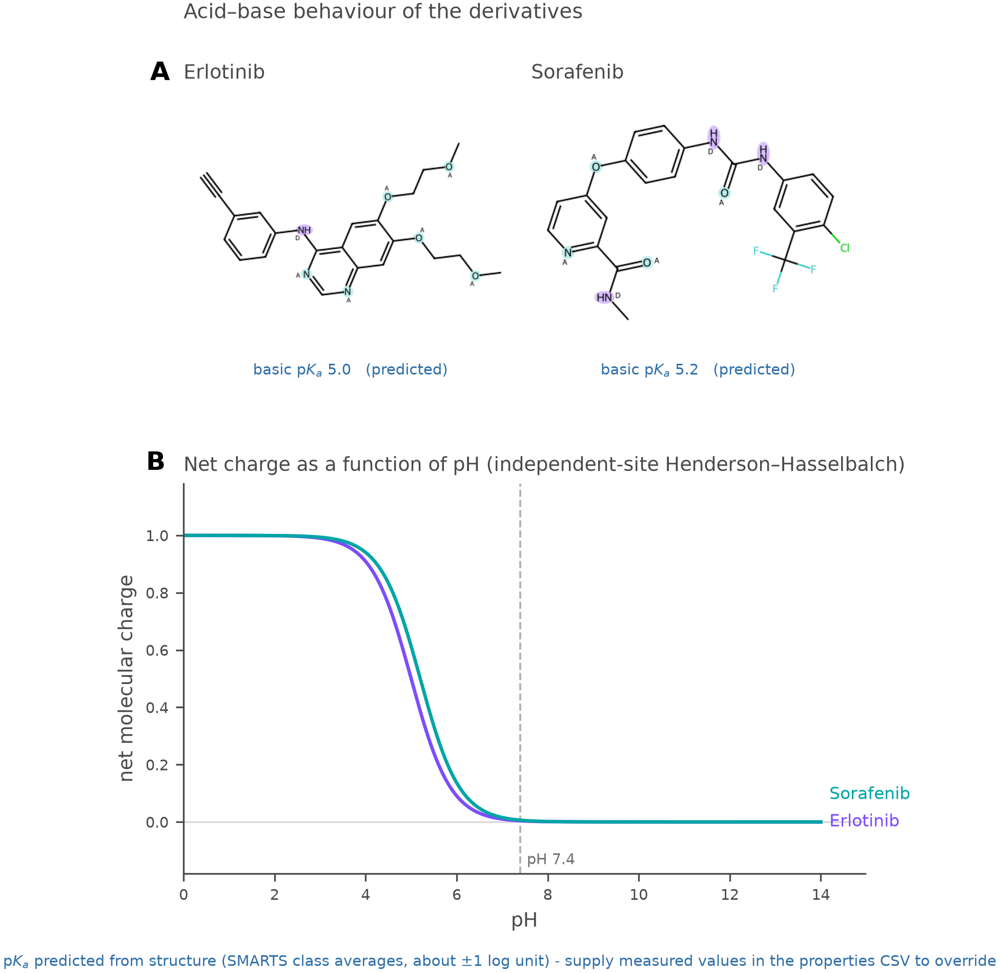

<p align="center">
  
</p>

# dftfig — automated DFT and figure pipeline for ORCA

[](https://github.com/MoazHosnyTaha/dftfig/actions/workflows/tests.yml)
[](https://github.com/MoazHosnyTaha/dftfig/actions/workflows/build.yml)
[](https://www.python.org)
[](LICENSE)

Give it structures; it gives you back the figures. dftfig drives ORCA through geometry
optimization, frequencies, a property single point and the N±1 single points, then renders
the result as publication-ready figures — with every parameter explained as you choose it,
and every number traceable to the calculation that produced it.

It exists because the gap between "the calculation finished" and "the figure is in the
manuscript" is usually a week of manual Avogadro, GaussView, PyMOL and Illustrator work
that nobody records, and that nobody can reproduce afterwards.

## Install

```bash
conda env create -f environment.yml && conda activate dftfig
pip install -e .
dft doctor          # confirms ORCA, PyMOL, cores and packages
```

`pip install dftfig` works too, but PyMOL is conda-only — without it the 3D panels are
skipped rather than failing. **ORCA is not included**: install it yourself (free for
academic use) and dftfig will find it. Linux and macOS are tested; see
[docs/usage.md](docs/usage.md#installing) for details.

## Run

```bash
mkdir my_project && cd my_project
dft init                       # scaffolds the folder
cp /path/to/*.sdf molecules/   # one file per compound
dft run                        # asks about every setting, then runs
```

**Structures are the only required input.** Charge and multiplicity come from the formal
charges in each file, so neutrals, cations and anions run together in one batch. MW, TPSA,
HBD, clogP, pKa, logD and the CNS MPO score are all derived from the connection table — you
supply nothing but the molecules. Measured values override the predictions if you have them.

`dft run` walks the pipeline in execution order and asks about each setting, showing what it
does, how to choose it and what it costs. Enter keeps the value shown.

## What comes out

| figure | shows |
|---|---|
| `frontier_orbitals` | optimized geometry with the minimum check, HOMO and LUMO with the gap, electrostatic potential on the electron density |
| `speciation` | every ionizable centre annotated, and net charge across pH 0–14 |
| `lipophilicity` | per-atom Crippen logP painted on the molecular surface |
| `mpo_metabolism` | logD against TPSA with the CNS MPO score, plus sites of metabolism from the radical Fukui index |

Plus `descriptors.csv` — every number behind the figures, with a `warnings` column — and
`manifest.json`, which `dft verify` checks against the files on disk.

## What the figures look like

Erlotinib and sorafenib, straight from their PubChem conformer SDFs, at
r2SCAN-3c/def2-TZVP in SMD water. Nothing was edited afterwards; every number on these
panels was parsed from the ORCA outputs, and the footnote carries the dftfig version and
a hash of the settings that produced them.



Geometry with the imaginary-frequency check, HOMO and LUMO with the gap
(3.159 and 3.307 eV), and V(r) on the 0.0004 a.u. density isosurface. The colour scale is
measured from the surfaces themselves and shared by both molecules, so the two panels can
be compared.



Hydrogen-bond donors and acceptors marked on the 2D structure, the predicted pKa on the
site it belongs to, and net charge across pH 0–14.


Per-atom logP contributions on the molecular surface, with TPSA and clogP beneath each.


logD against TPSA inside the CNS MPO desirable box, bubble area scaled by predicted
permeability, and the most labile position from the radical Fukui index.

The molecules are named `Conformer3D_COMPOUND_CID_176870` and `..._216239` on disk,
because that is what a PubChem download is called. `figures.labels` maps those to
Erlotinib and Sorafenib for the figures only — the run directories keep their own names,
so relabelling costs one `dft run figures` and recomputes nothing.

## Commands

```
dft run            walk the settings, then run everything
dft run opt sp     named stages only, no questions
dft doctor         what this machine provides
dft status         what is done, missing, or not a minimum
dft validate       check settings against this machine
dft params [KEY]   the parameter reference
dft verify         confirm the results match the manifest
```

## Documentation

| | |
|---|---|
| [Usage](docs/usage.md) | installing, the ten setting steps, stages, inputs, runtimes |
| [Methods](docs/methods.md) | which choices matter, how pKa and logD are derived, what is checked, what it cannot do |
| [Writing a figure](docs/writing-a-figure.md) | the plugin API, with a worked example |
| [Parameter reference](docs/parameter_reference.md) | all 96 parameters |
| [Troubleshooting](docs/troubleshooting.md) | symptoms and fixes |

## Extending

Figures are plugins. Drop a `.py` file into `./dft_figures` declaring `NAME`, `TITLE`,
`REQUIRES` and `build(ctx)`, and it appears in `figures.which` — no install, no edit to
dftfig. The four built-ins are the reference implementations;
[examples/fukui_bars](examples/fukui_bars/) is a complete one in 59 lines.

## Known limits

Closed-shell organics. No ECPs or transition metals, no excited states. The pKa model is
SMARTS class averages (about ±1 log unit, validated against 17 reference compounds in
`tests/test_pka.py`, with one documented failure). Permeability, clearance and protein
binding have no structural estimate — supply them or the panels say so.

## Citing dftfig

```bibtex
@software{hassanein_dftfig_2026,
  author  = {Hassanein, Moaz H. T.},
  title   = {{dftfig}: an automated ORCA DFT and figure pipeline for molecular structures},
  version = {0.6.0},
  year    = {2026},
  url     = {https://github.com/MoazHosnyTaha/dftfig},
  note    = {ORCID 0009-0001-1389-9305}
}
```

> Hassanein, M. H. T. (2026). *dftfig: an automated ORCA DFT and figure pipeline for
> molecular structures* (version 0.6.0) [Computer software].
> https://github.com/MoazHosnyTaha/dftfig

Use the version you actually ran — `dft --version`, or read it from `descriptors.csv` or the
figure stamp. **Also cite what did the work:** dftfig orchestrates other people's software
and computes nothing itself, so cite **ORCA** (the version in your `descriptors.csv`),
**RDKit**, and **PyMOL** if you show the 3D panels. There is no DOI yet; one comes with the
first archived release.

## Contributing

Issues and questions: <https://github.com/MoazHosnyTaha/dftfig/issues> — usage questions
welcome, not only bugs. Please include the output of `dft doctor`. See
[CONTRIBUTING.md](CONTRIBUTING.md); contributors are expected to follow the
[Code of Conduct](CODE_OF_CONDUCT.md).

Maintainer: Moaz H. T. Hassanein, Department of Pharmaceutical Chemistry, Faculty of
Pharmacy, Sinai University — Kantara Branch, Ismailia, Egypt.
<moaz.hassanein@su.edu.eg> · [ORCID 0009-0001-1389-9305](https://orcid.org/0009-0001-1389-9305)

MIT licensed — see [LICENSE](LICENSE) and [THIRD_PARTY.md](THIRD_PARTY.md).
