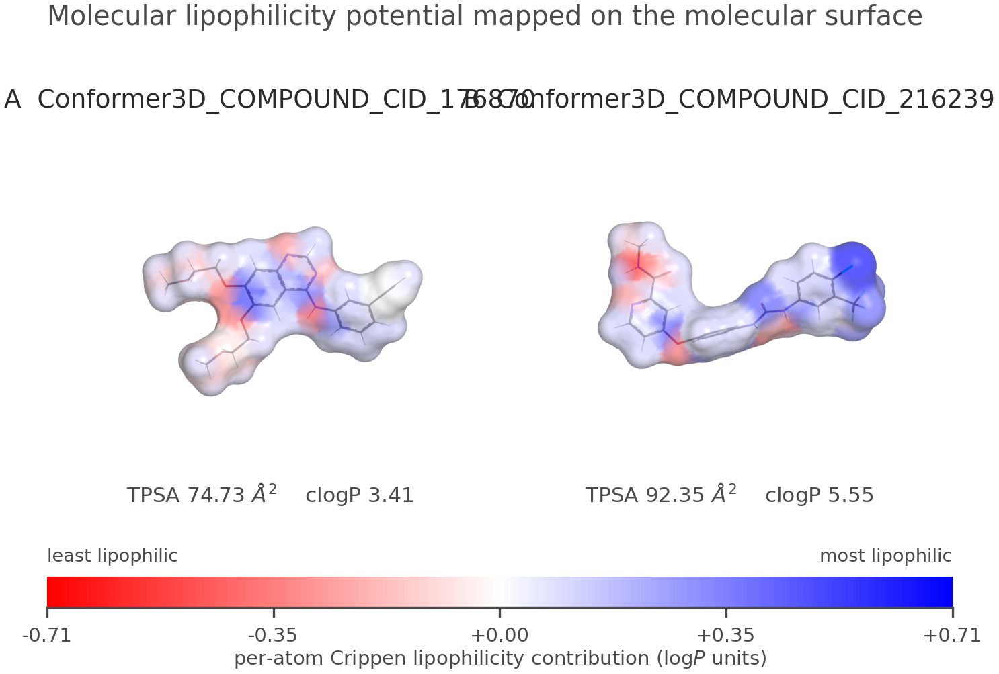
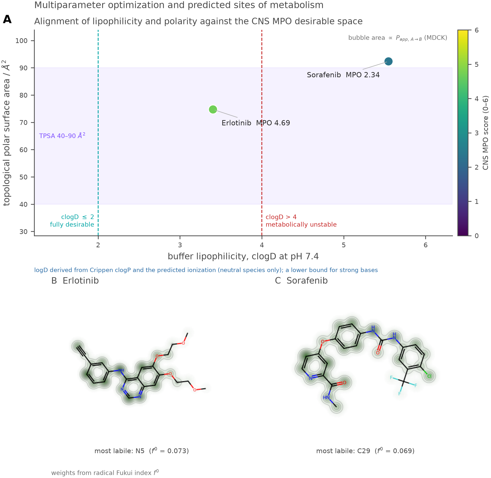

<p align="center">
  
</p>

# dftfig — automated DFT and figure pipeline for ORCA

[](https://github.com/MoazHosnyTaha/dftfig/actions/workflows/tests.yml)
[](https://github.com/MoazHosnyTaha/dftfig/actions/workflows/build.yml)
[](https://www.python.org)
[](LICENSE)
[](https://doi.org/10.5281/zenodo.24472276)

Give it structures; it gives you back the figures. dftfig drives ORCA through geometry
optimization, frequencies, a property single point and the N±1 single points, then renders
the result as publication-ready figures — with every parameter explained as you choose it,
and every number traceable to the calculation that produced it.

It exists because the gap between "the calculation finished" and "the figure is in the
manuscript" is usually a week of manual Avogadro, GaussView, PyMOL and Illustrator work
that nobody records, and that nobody can reproduce afterwards.

## Install

Three pieces: the Python package, PyMOL for the 3D panels, and ORCA itself. The first two
come from one conda environment; ORCA you install separately.

**1. Clone the repository**

```bash
git clone https://github.com/MoazHosnyTaha/dftfig.git
cd dftfig
```

**2. Create the environment.** conda is recommended because it is the only way to get the
open-source PyMOL build:

```bash
conda env create -f environment.yml   # Python 3.11, RDKit, PyMOL, matplotlib, cclib
conda activate dftfig
pip install -e .                      # puts the `dft` command on your PATH
```

`mamba env create -f environment.yml` does the same thing faster. Python 3.10 or newer is
required.

If you would rather use an environment you already have, `pip install dftfig` brings RDKit
and everything else — but not PyMOL, whose open-source build is not on PyPI. Without it
the 3D panels of `frontier_orbitals` and `lipophilicity` are skipped with a message rather
than failing; add it later with `conda install -c conda-forge pymol-open-source`.

**3. Install ORCA.** It is not bundled and is not a Python dependency. ORCA is free for
academic use: register and download 6.x from the
[ORCA forum](https://orcaforum.kofo.mpg.de), then unpack it anywhere you like. dftfig
finds it by itself — it checks `$ORCA_PATH`, then your `PATH`, then the usual locations
(`~/orca*`, `/opt/orca*`, `/usr/local/orca*`, `/share/apps/orca*`) and remembers the
result in `~/.config/dftfig/paths.yaml`. A candidate only counts if `orca_plot` and
`orca_vpot` sit beside it, because on most Linux desktops `/usr/bin/orca` is the GNOME
**screen reader** and running that instead fails in a way that makes no sense. Set
`execution.orca_path` if you keep several ORCA versions.

**4. Check what your machine provides**

```bash
dft doctor
```

```
  OK  ORCA: /opt/orca_6_1_0/orca
      version 6.1.0
  OK  PyMOL: /home/you/miniconda3/envs/dftfig/bin/pymol
  OK  python packages: all present
  OK  steric descriptors: MORFEUS present
```

Linux and macOS are tested. Windows is expected to work and is not in the tested matrix:
the arrow-key menus need termios, so there every question falls back automatically to a
numbered prompt that takes the same answers. More detail in
[docs/usage.md](docs/usage.md#installing).

## Try it first — no ORCA needed

```bash
dft demo
```

A finished calculation ships with the package, so you can see every figure and both
descriptor tables in about half a minute without installing ORCA or waiting on a single
SCF cycle. Steps 3 and 4 above are not needed for this.

What is bundled is a real run, not a mock: aniline and phenol at B3LYP-D3BJ/def2-SVP with
a def2-TZVP property single point in CPCM water, with the genuine ORCA outputs and the
real cubes that calculation produced. `dft demo` unpacks them into `./dftfig-demo` and
runs the two stages that need no quantum chemistry — descriptors and figures — against
them, exactly as it would on your own compounds.

The pair is chosen rather than arbitrary. Aniline is a base and phenol is an acid, so the
speciation figure shows one curve rising and one falling on the same pH axis, and the
electrostatic potential panels share a single colour scale across both molecules. The
config that produced it is left in `dftfig-demo/config.yaml`: change something and re-run
`dft figures -c dftfig-demo/config.yaml` to see what that setting does, still without
ORCA.

## Run

```bash
mkdir my_project && cd my_project
dft init                       # scaffolds the folder
cp /path/to/*.sdf molecules/   # one file per compound
dft run                        # asks about every setting, then runs
```

**Structures are the only required input.** Charge and multiplicity come from the formal
charges in each file, so neutrals, cations and anions run together in one batch. MW, TPSA,
HBD, clogP, pKa, logD and the CNS MPO score are all derived from the connection table — you
supply nothing but the molecules. Measured values override the predictions if you have them.

`dft run` walks the pipeline in execution order and asks about each setting, showing what it
does, how to choose it and what it costs. Enter keeps the value shown.

## What comes out

| figure | shows |
|---|---|
| `frontier_orbitals` | optimized geometry with the minimum check, HOMO and LUMO with the gap, electrostatic potential on the electron density |
| `speciation` | every ionizable centre annotated, and net charge across pH 0–14 |
| `lipophilicity` | per-atom Crippen logP painted on the molecular surface |
| `mpo_metabolism` | logD against TPSA with the CNS MPO score, plus sites of metabolism from the radical Fukui index |

Plus two descriptor tables and a manifest:

| file | contents |
|---|---|
| `descriptors.csv` | one row per molecule × medium: every number behind the figures, a `warnings` column, and the whole-molecule descriptor set — electronic (IE, EA, χ, μ, η, ω, thermochemistry) beside steric and shape (SASA, dispersion P<sub>int</sub>, the inertial shape indices) |
| `atom_descriptors.csv` | one row per atom: condensed Fukui functions and charges beside per-atom SASA, dispersion, buried volume and pyramidalization — a feature matrix ready for a QSAR or machine-learning model |
| `manifest.json` | versions, settings hash and a SHA-256 per file, which `dft verify` checks against what is on disk |

The steric descriptors come from [MORFEUS](https://github.com/digital-chemistry-laboratory/morfeus)
and RDKit, computed on the geometry ORCA already optimized — no extra quantum chemistry
and no external program. They describe that one optimized conformer, not a
Boltzmann-weighted ensemble. Set `property.sterics: false` to skip them.

## What the figures look like

Erlotinib and sorafenib, straight from their PubChem conformer SDFs, at
r2SCAN-3c/def2-TZVP in SMD water. Nothing was edited afterwards; every number on these
panels was parsed from the ORCA outputs, and the footnote carries the dftfig version and
a hash of the settings that produced them.


Geometry with the imaginary-frequency check, HOMO and LUMO with the gap
(3.159 and 3.307 eV), and V(r) on the 0.0004 a.u. density isosurface. The colour scale is
measured from the surfaces themselves and shared by both molecules, so the two panels can
be compared.


Hydrogen-bond donors and acceptors marked on the 2D structure, the predicted pKa on the
site it belongs to, and net charge across pH 0–14.



Per-atom logP contributions on the molecular surface, with TPSA and clogP beneath each.



logD against TPSA inside the CNS MPO desirable box, bubble area scaled by predicted
permeability, and the most labile position from the radical Fukui index.

## Commands

```
dft run            walk the settings, then run everything
dft run opt sp     named stages only, no questions
dft doctor         what this machine provides
dft status         what is done, missing, or not a minimum
dft validate       check settings against this machine
dft params [KEY]   the parameter reference
dft verify         confirm the results match the manifest
```

## Documentation

| | |
|---|---|
| [Usage](docs/usage.md) | installing, the ten setting steps, stages, inputs, runtimes |
| [Methods](docs/methods.md) | which choices matter, how pKa and logD are derived, what is checked, what it cannot do |
| [Writing a figure](docs/writing-a-figure.md) | the plugin API, with a worked example |
| [Parameter reference](docs/parameter_reference.md) | all 96 parameters |
| [Troubleshooting](docs/troubleshooting.md) | symptoms and fixes |

## Extending

Figures are plugins. Drop a `.py` file into `./dft_figures` declaring `NAME`, `TITLE`,
`REQUIRES` and `build(ctx)`, and it appears in `figures.which` — no install, no edit to
dftfig. The four built-ins are the reference implementations;
[examples/fukui_bars](examples/fukui_bars/) is a complete one in 59 lines.

## Known limits

Closed-shell organics. No ECPs or transition metals, no excited states. The pKa model is
SMARTS class averages (about ±1 log unit, validated against 17 reference compounds in
`tests/test_pka.py`, with one documented failure). Permeability, clearance and protein
binding have no structural estimate — supply them or the panels say so.

## Citing dftfig

Each release is archived on Zenodo. Cite the DOI, not the repository URL.

```bibtex
@software{hassanein_dftfig_2026,
  author    = {Hassanein, Moaz H. T.},
  title     = {{dftfig}: an automated ORCA DFT and figure pipeline for molecular structures},
  version   = {0.10.0},
  year      = {2026},
  publisher = {Zenodo},
  doi       = {10.5281/zenodo.24472276},
  url       = {https://doi.org/10.5281/zenodo.24472276},
  note      = {ORCID 0009-0001-1389-9305}
}
```

> Hassanein, M. H. T. (2026). *dftfig: an automated ORCA DFT and figure pipeline for
> molecular structures* (version 0.10.0) [Computer software]. Zenodo.
> https://doi.org/10.5281/zenodo.24472276

`10.5281/zenodo.24472276` always resolves to the latest version. To pin the exact release you ran, use
its version DOI instead — 0.10.0 is `10.5281/zenodo.24536738`, and every release lists its own on its
Zenodo page.

Use the version you actually ran — `dft --version`, or read it from `descriptors.csv` or
the figure stamp. **Also cite what did the work:** dftfig orchestrates other people's
software and computes nothing itself, so cite **ORCA** (the version in your
`descriptors.csv`), **RDKit**, **PyMOL** if you show the 3D panels, and **MORFEUS** if
you report the steric descriptors.

## Contributing

Issues and questions: <https://github.com/MoazHosnyTaha/dftfig/issues> — usage questions
welcome, not only bugs. Please include the output of `dft doctor`. See
[CONTRIBUTING.md](CONTRIBUTING.md); contributors are expected to follow the
[Code of Conduct](CODE_OF_CONDUCT.md).

Maintainer: Moaz H. T. Hassanein, Department of Pharmaceutical Chemistry, Faculty of
Pharmacy, Sinai University — Kantara Branch, Ismailia, Egypt.
<moaz.hassanein@su.edu.eg> · [ORCID 0009-0001-1389-9305](https://orcid.org/0009-0001-1389-9305)

MIT licensed — see [LICENSE](LICENSE) and [THIRD_PARTY.md](THIRD_PARTY.md).
